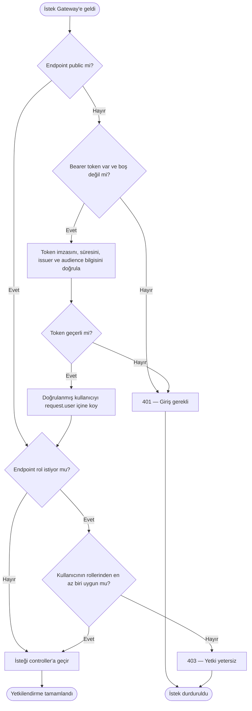

# D-05 — Gateway istek yetkilendirme

Gateway önce token'ı, sonra endpoint'in istediği rolü kontrol eder.
Kontroller geçerse istek controller'a ulaşır.

- Token kontrolünü `JwtAuthGuard`, rol kontrolünü `RolesGuard` yapıyor.
- Public endpoint'te token kontrolü atlanır. Rol kontrolü yine çalışır;
  public bir endpoint'e rol şartı eklenirse kullanıcı bilgisi olmadığı için
  istek 403 alır.
- Roller token içindeki `realm_access.roles` alanından okunur.
- Örneğin birim oluşturma için `admin` veya `operator` rollerinden biri yeterlidir.
- Token'ın imzası Keycloak public key'leriyle kontrol edilir. Key'ler gerektiğinde
  alınır ve cache'lenir; her istekte Keycloak'a doğrulama isteği gönderilmez.
- Yetkilendirmeden sonra DTO kontrolü ve endpoint'in kendi işlemleri çalışır.
  Yetkinin olması, işlemin mutlaka başarılı olacağı anlamına gelmez.

Bu çizim Gateway'e ulaşmış isteği gösterir. Web tarafındaki oturum ve token
yenileme akışı D-04'te yer alıyor.
