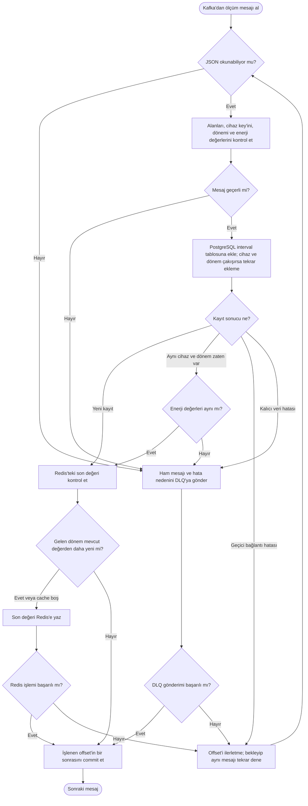

# D-06 — Ölçüm alım akışı

Bu çizim Ingestion'ın ölçüm işleme akışını gösterir.
Consumer, validator, kayıt, Redis ve DLQ adımları uygulandı.

Ingestion mesajı Kafka'dan alır. Geçerli ölçümü PostgreSQL'e yazar,
hatalı mesajı ise nedenini ekleyerek DLQ'ya gönderir.

F3-T4 ile consumer mevcut mesajları en fazla 500'lük parçalarda işler;
500 mesaj dolmasını beklemez. Normal yolda parça başına tek INSERT ve
toplu karşılaştırma sorgusu kullanılır. Redis ve DLQ gönderimleri de topludur.
Parçadaki bütün gerekli işler tamamlanınca son mesajın offset'i + 1 commit edilir.
`MEASUREMENT_WRITE_MODE=single` tekli karşılaştırma yolunu açar.

## Neleri kontrol edeceğiz?

- Beklenen mesaj sürümü ve zorunlu alanlar doğru mu?
- Cihaz kimliği geçerli mi, Kafka key'i `deviceId` ile aynı mı?
- `periodStart` geçerli ve 15 dakika sınırına hizalı mı?
- `intervalMinutes` değeri 15 mi, dönem tamamlanmış mı?
- Dört enerji değeri sonlu bir sayı mı ve sıfırdan büyük veya eşit mi?

## Tekrar gelen mesajlar

Tekrar kontrolü `(device_id, period_start)` üzerinden yapılacak.
Veritabanındaki unique constraint, aynı ölçümün iki kez yazılmasını önleyecek.
Önce sorgulayıp sonra eklemek yerine, ekleme sırasında çakışma yönetilecek.

Aynı dönem ve aynı enerji değerleri gelirse tekrar kayıt oluşturulmayacak.
Aynı döneme farklı enerji gelirse eski kaydın üzerine yazılmayacak;
mesaj çakışma nedeniyle DLQ'ya gidecek. Bu, düzeltme mesajlarını ayrıca
tasarlayana kadar kullanacağımız kural.

## Son değer ve backfill

Son değer, mesajın geliş zamanına göre değil `periodStart` ile seçilecek.
Örneğin bugünkü ölçüm cache'teyken geçmiş bir backfill mesajı gelirse
PostgreSQL'e kaydedilecek ama son değeri geriye çekmeyecek.
Redis'teki karşılaştırma ve yazma tek bir atomik işlem olmalı.

## Hata ve offset

- Kafka mesajı okununca hemen işlenmiş sayılmayacak.
- Geçerli ölçüm için veritabanı ve son değer adımları bitince offset ilerleyecek.
- Hatalı mesaj için DLQ gönderimi onaylanınca offset ilerleyecek.
- Bağlantı hatasında offset ilerlemeyecek. Aynı partition'da bu mesajın
  ilerisindeki mesajlar işlenmiş gibi commit edilmeyecek.
- PostgreSQL kaydından sonra uygulama kapanırsa mesaj yeniden gelebilir.
  Unique constraint ikinci kaydı önler, son değer adımı tekrar çalışabilir.
- DLQ gönderiminden sonra offset yazılamazsa aynı hata mesajı DLQ'ya tekrar
  gelebilir. Kafka ile PostgreSQL'i kapsayan ortak bir transaction yok.

`corrupt` mesajı DLQ'ya gider. `duplicate` ikinci bir ölçüm kaydı oluşturmaz.
`missing` modunda mesaj gelmediği için bu akış çalışmaz; eksik dönemleri
tespit etmek ayrı bir iştir.

DLQ topic'i: `mpms.measurement.dlq`.
Kayıt tablosu: `mini_pms.interval`.
