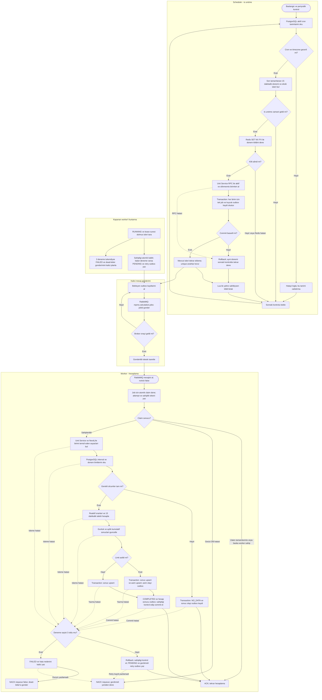

# D-08 — 15 dakikalık hesap döngüsü

F4 için planlanan akış. Scheduler ve worker henüz uygulanmadı.
İkisi calculation-service içinde çalışır; ayrı mikroservis açılmaz.
Scheduler iş oluşturur, worker hesabı yapar.

## Kilit ve tekrar kontrolu

- Kilit anahtarı: `lock:scheduler:{periodStart}`. Değer rastgele sahiplik ID'si, TTL 60 saniye.
- Üç replika aynı UTC dönemini hesaplar. Kilit alınamazsa kontrol daha sonra tekrarlanır.
- İş üretimi uzarsa kilit yalnız sahibi tarafından yenilenir. Sahiplik kaybolursa yeni üretim durur.
- Redis kilidi bitse bile job unique anahtarı duplicate kaydı önler.
- Her aktif birim için bir `ENERGY_CALCULATION` işi vardır. Örneğin 3 birim için dönem başına
  3 iş gerekir; 3 replika çalıştığında toplam 9 olmaz.
- Güncel cron tanımları tekrar okunur; pasif veya değişen tanımın eski zamanlaması kaldırılır.
- Servis açılınca kaçan dönemler kontrol edilir. İlk başlangıç sınırı metadata/seed ile açık seçilir;
  tüm geçmişi kendiliğinden hesaplamaya başlamaz.

## Worker ve ACK

- Mesaj `{ jobId }` taşır. Prefetch ortam değişkeninden okunur.
- Atomik claim, koşullu UPDATE ile yapılır. Deneme sayısı işi sahiplenince artar; mesaj tekrarında artmaz.
- Her çalıştırmada farklı token vardır. Sonuç yazan transaction, token ve lease hâlâ geçerli mi kontrol eder.
  Lease yenilenir; sahipliği kaybeden eski worker sonuç yazamaz.
- Gerekli veri eksikse kısmi toplamdan sonuç üretmek yerine `NO_DATA` kaydedilir.
- `RUNNING`, yönergedeki `IN_PROGRESS` karşılığıdır. Mevcut durum adını koruyoruz.
- İş ve sonuç transaction'ı tamamlanmadan ACK verilmez. Retry gerekiyorsa yeni deneme kalıcı
  planlandıktan sonra eski mesaj ACK edilir. Böylece hızlı NACK döngüsü oluşturulmaz.
- Üçüncü işleme hatasında FAILED yazıldıktan sonra NACK requeue=false ile
  `mpms.calculation.jobs.dlx` dead-letter exchange'ine gider; bağlı hata kuyruğunda incelenir.
- Bozuk/olmayan job ID mesajları hesaplamaya girmeden hata nedeniyle dead-letter'a ayrılır.
- Worker kapanınca RabbitMQ mesajı yeniden teslim edebilir. Yeni worker aktif lease varken
  işi alamaz; recovery süresi dolan işi tekrar kuyruğa koyar.

## Mesaj neden outbox'a yaziliyor?

Job kaydedildikten hemen sonra uygulama kapanırsa RabbitMQ mesajı kaybolmasın diye.
`event_outbox` job ile aynı transaction'da yazılır. Gönderici, broker onayı gelene kadar dener.
Sonuç ve aşım olaylarında da aynı yol kullanılır; topic'ler `mpms.calculation.result`
ve `mpms.limit.exceeded`. Mesaj tekrar gelebilir; job ID/event ID kontrolü tekrar işlemi önler.
Tablo ve yeni alanlar D-02'de plan olarak gösterildi; henüz kodlanmadı.

## Kontrol edecegimiz senaryolar

- 3 replika ve 3 aktif birimde, her dönem için tam 3 job oluşması.
- Scheduler kayıt sırasında kapanınca eksik işlerin sonraki kontrolde tamamlanması.
- Aynı mesaj tekrar geldiğinde tamamlanmış işin yeniden hesaplanmaması.
- Worker hesap ortasında kapanınca lease sonunda işin kurtarılması.
- Üç denemeden sonra FAILED ve dead-letter; ölçüm yokken NO_DATA.
- Aynı dönemi yeniden hesaplayınca sonuç ve aşım kayıtlarının çiftlenmemesi.
