```mermaid
erDiagram

    unit {
        bigint id PK "NOT NULL"
        bigint parent_id FK "NULL"
        varchar code UK "NOT NULL"
        varchar name "NOT NULL"
        varchar unit_type "NOT NULL"
        timestamptz created_at "NOT NULL"
        varchar created_by "NOT NULL"
        timestamptz deleted_at "NULL"
        varchar deleted_by "NULL"
    }

    unit_log {
    bigint id PK "NOT NULL"
    bigint unit_id FK "NOT NULL"
    varchar action "NOT NULL"
    jsonb changes "NOT NULL"
    timestamptz created_at "NOT NULL"
    varchar created_by "NOT NULL"
    }


    meter {
        bigint id PK "NOT NULL"
        bigint unit_id FK "NOT NULL"
        varchar serial_no UK "NOT NULL"
        varchar role "NOT NULL"
        boolean is_active "NOT NULL"
        timestamptz created_at "NOT NULL"
        varchar created_by "NOT NULL"
        timestamptz deleted_at "NULL"
        varchar deleted_by "NULL"
    }
    meter_log {
    bigint id PK "NOT NULL"
    bigint meter_id FK "NOT NULL"
    varchar action "NOT NULL"
    jsonb changes "NOT NULL"
    timestamptz created_at "NOT NULL"
    varchar created_by "NOT NULL"
}
    

    reactive_limit_config {
        bigint id PK "NOT NULL"
        bigint unit_id FK "NOT NULL"
        varchar limit_type "NOT NULL"
        numeric limit_value "NOT NULL"
        timestamptz valid_from "NOT NULL"
        timestamptz valid_to "NULL"
    }

    measurement {
        bigint id PK "NOT NULL"
        bigint meter_id FK "NOT NULL"
        timestamptz period_start "NOT NULL"
        numeric active_import_kwh "NOT NULL"
        numeric active_export_kwh "NOT NULL"
        numeric inductive_kvarh "NOT NULL"
        numeric capacitive_kvarh "NOT NULL"
    }

    cron_job_definition {
        bigint id PK "NOT NULL"
        varchar job_name UK "NOT NULL"
        varchar cron_expression "NOT NULL"
        boolean is_active "NOT NULL"
    }

    calculation_job {
        bigint id PK "NOT NULL"
        bigint unit_id FK "NOT NULL"
        bigint cron_job_definition_id FK "NULL"
        timestamptz period_start "NOT NULL"
        varchar status "NOT NULL"
        integer retry_count "NOT NULL"
        timestamptz created_at "NOT NULL"
    }

    reactive_result {
        bigint id PK "NOT NULL"
        bigint unit_id FK "NOT NULL"
        bigint calculation_job_id FK "NOT NULL"
        timestamptz period_start "NOT NULL"
        varchar period_type "NOT NULL"
        numeric inductive_ratio "NULL"
        numeric capacitive_ratio "NULL"
    }

    demand_result {
        bigint id PK "NOT NULL"
        bigint unit_id FK "NOT NULL"
        bigint calculation_job_id FK "NOT NULL"
        timestamptz period_start "NOT NULL"
        numeric demand_kw "NOT NULL"
    }

    limit_exceedance {
        bigint id PK "NOT NULL"
        bigint unit_id FK "NOT NULL"
        bigint calculation_job_id FK "NOT NULL"
        bigint alarm_id FK "NULL"
        timestamptz period_start "NOT NULL"
        varchar exceedance_type "NOT NULL"
        numeric measured_value "NOT NULL"
        numeric limit_value "NOT NULL"
    }

    alarm {
        bigint id PK "NOT NULL"
        bigint unit_id FK "NOT NULL"
        varchar alarm_type "NOT NULL"
        varchar status "NOT NULL"
        integer occurrence_count "NOT NULL"
        timestamptz last_seen_at "NOT NULL"
        varchar acknowledged_by "NULL"
    }

    report_request {
        bigint id PK "NOT NULL"
        bigint unit_id FK "NOT NULL"
        varchar report_type "NOT NULL"
        varchar status "NOT NULL"
        jsonb parameters "NOT NULL"
        varchar requested_by "NOT NULL"
        timestamptz created_at "NOT NULL"
    }

    unit o|--o{ unit : parent
    unit ||--o{ unit_log : logs
    unit ||--o{ meter : meters
    meter ||--o{ meter_log : logs
    unit ||--o{ reactive_limit_config : limits
    meter ||--o{ measurement : measurements

    unit ||--o{ calculation_job : jobs
    cron_job_definition o|--o{ calculation_job : schedules

    calculation_job ||--o{ reactive_result : produces
    calculation_job ||--o{ demand_result : produces
    calculation_job ||--o{ limit_exceedance : detects

    unit ||--o{ reactive_result : reactive
    unit ||--o{ demand_result : demand
    unit ||--o{ limit_exceedance : exceedances

    unit ||--o{ alarm : alarms
    alarm o|--o{ limit_exceedance : associated_with

    unit ||--o{ report_request : reports
```

## 2. Constraints and Indexes

All tables belong to the `mini_pms` schema.

```sql
-- Prevent duplicate measurements for the same meter and period.
ALTER TABLE mini_pms.measurement
ADD CONSTRAINT uq_measurement_meter_period
UNIQUE (meter_id, period_start);

-- Support efficient scanning of calculation jobs.
CREATE INDEX idx_calculation_job_status_period
ON mini_pms.calculation_job (status, period_start);

-- Allow at most one active MAIN meter per unit.
CREATE UNIQUE INDEX uq_meter_active_main
ON mini_pms.meter (unit_id)
WHERE role = 'MAIN'
  AND is_active = TRUE
  AND deleted_at IS NULL;

-- Allow at most one non-closed alarm per unit and type.
CREATE UNIQUE INDEX uq_alarm_active
ON mini_pms.alarm (unit_id, alarm_type)
WHERE status <> 'CLOSED';

-- Prevent duplicate system-generated reports.
CREATE UNIQUE INDEX uq_report_system_period
ON mini_pms.report_request (
    report_type,
    unit_id,
    (parameters->>'period')
)
WHERE requested_by = 'system';

-- Prevent duplicate reactive results for the same period.
CREATE UNIQUE INDEX uq_reactive_result_period
ON mini_pms.reactive_result
(unit_id, period_type, period_start);

-- Prevent duplicate demand results for the same period.
CREATE UNIQUE INDEX uq_demand_result_period
ON mini_pms.demand_result (unit_id, period_start);

-- Prevent duplicate exceedance records after recalculation.
CREATE UNIQUE INDEX uq_limit_exceedance_period
ON mini_pms.limit_exceedance
(unit_id, period_start, exceedance_type);
```

The first five constraints/indexes are explicitly required by D-02.
The final three are proposed design constraints to support
idempotent recalculation and upsert operations.

## 3. Status and Type Values

| Field | Allowed Values |
|---|---|
| `unit.unit_type` | `SUBSTATION`, `TRANSFORMER`, `FEEDER` |
| `meter.role` | `MAIN`, `FEEDER` |
| `calculation_job.status` | `PENDING`, `IN_PROGRESS`, `COMPLETED`, `FAILED`, `NO_DATA` |
| `reactive_result.period_type` | `QUARTER_HOUR`, `DAILY`, `MONTHLY` |
| `limit_exceedance.exceedance_type` | `INDUCTIVE`, `CAPACITIVE`, `IMPORT_DEMAND`, `EXPORT_DEMAND` |
| `alarm.alarm_type` | `INDUCTIVE`, `CAPACITIVE`, `IMPORT_DEMAND`, `EXPORT_DEMAND` |
| `alarm.status` | `OPEN`, `ACKNOWLEDGED`, `CLOSED` |
| `report_request.report_type` | `MONTHLY_REACTIVE`, `EXCEEDANCE_LIST` |
| `report_request.status` | `PENDING`, `IN_PROGRESS`, `COMPLETED`, `FAILED` |
| `unit_log.action`, `meter_log.action` | `CREATE`, `UPDATE`, `DELETE` |

These values form the proposed initial application model.
Values not explicitly defined in the requirements must be
confirmed before implementing migrations.

## 4. Audit and Soft Delete

- `created_at` stores the record creation timestamp.
- `created_by` stores the username responsible for creation.
- `deleted_at` and `deleted_by` support soft deletion.
- `unit_log` and `meter_log` preserve changes to unit and meter data.
- `acknowledged_by` identifies the operator who acknowledged an alarm.
- `requested_by` identifies the user or system requesting a report.

User identities are managed by Keycloak.
The `preferred_username` claim from the access token is stored
in audit fields. Mini-PMS does not maintain a local user table.

## 5. Business Rules

### 5.1 Unit Hierarchy

The `unit.parent_id` field references `unit.id`.

The hierarchy has three levels:
SUBSTATION -> TRANSFORMER -> FEEDER.

PostgreSQL recursive CTEs can retrieve the hierarchy.
Neo4j is used for topology traversal.

### 5.2 Meter Selection

Each unit can have at most one active, non-deleted MAIN meter.

Calculation logic must select the correct MAIN meters to avoid
double-counting energy measurements.

### 5.3 Reactive Calculation

Reactive ratios are calculated using:

Inductive ratio = SUM(inductive_kvarh) / SUM(active_import_kwh)

Capacitive ratio = SUM(capacitive_kvarh) / SUM(active_import_kwh)

Daily and monthly ratios use aggregated energy values,
not averages of individual 15-minute ratios.

Division by zero must be handled.

### 5.4 Demand Calculation

For a 15-minute interval:

Demand (kW) = Active energy (kWh) * 4

The calculated demand is compared with the configured
consumption or production power limit.

### 5.5 Limit Exceedance and Alarm

Configured limits are stored in the limit configuration model.

When a calculated value exceeds its applicable limit,
a `limit_exceedance` record is created.

The Alarm Service processes exceedance events and creates
or updates an alarm.

An existing non-closed alarm for the same unit and alarm type
must be updated rather than duplicated.

### 5.6 Calculation Jobs

The scheduler reads `cron_job_definition`.

Every 15 minutes, calculation jobs are created for active units.

Workers process jobs through RabbitMQ.

A failed job can be retried up to three times.
A job with missing measurement data can enter `NO_DATA`.

## 6. Data Growth

The `measurement` table is expected to grow fastest.

500 meters * 96 intervals/day * 365 days
= 17,520,000 rows/year.

Monthly table partitioning is an optional optimization.

## 7. Migration Rules

- The ERD is the source of truth for database migrations.
- Every migration PR must include the updated ERD.
- Primary keys use auto-incrementing `bigint`.
- Timestamps use `timestamptz` and UTC.
- Energy and ratio values use `numeric`.
 beginning of F3, F4, and F5.
```
