# D-02 — Entity Relationship Diagram

## 1. Entity Relationship Diagram

```mermaid
erDiagram

    organization_unit_type {
        bigint id PK "NOT NULL"
        varchar type UK "NOT NULL"
    }

    organization_unit {
        bigint id PK "NOT NULL"
        bigint parent_id FK "NULL"
        bigint organization_unit_type_id FK "NOT NULL"
        varchar code UK "NOT NULL"
        varchar name "NOT NULL"
        boolean is_active "NOT NULL, DEFAULT TRUE"
        boolean is_deleted "NOT NULL, DEFAULT FALSE"
        timestamptz created_at "NOT NULL"
        varchar created_by "NOT NULL"
        timestamptz deleted_at "NULL"
        varchar deleted_by "NULL"
    }

    organization_unit_log {
        bigint id PK "NOT NULL"
        bigint organization_unit_id FK "NOT NULL"
        varchar action "NOT NULL"
        jsonb changes "NOT NULL"
        timestamptz created_at "NOT NULL"
        varchar created_by "NOT NULL"
    }

    device {
        bigint id PK "NOT NULL"
        bigint organization_unit_id FK "NOT NULL"
        varchar serial_no UK "NOT NULL"
        varchar role "NOT NULL"
        jsonb metadata "NOT NULL, DEFAULT {}"
        boolean is_active "NOT NULL, DEFAULT TRUE"
        timestamptz created_at "NOT NULL"
        varchar created_by "NOT NULL"
        timestamptz deleted_at "NULL"
        varchar deleted_by "NULL"
    }

    device_log {
        bigint id PK "NOT NULL"
        bigint device_id FK "NOT NULL"
        varchar action "NOT NULL"
        jsonb changes "NOT NULL"
        timestamptz created_at "NOT NULL"
        varchar created_by "NOT NULL"
    }

    reactive_limit_config {
        bigint id PK "NOT NULL"
        bigint organization_unit_id FK "NOT NULL"
        varchar limit_type "NOT NULL"
        numeric limit_value "NOT NULL"
        timestamptz valid_from "NOT NULL"
        timestamptz valid_to "NULL"
    }

    interval {
        bigint id PK "NOT NULL"
        bigint device_id FK "NOT NULL"
        timestamptz period_start "NOT NULL"
        numeric active_import_kwh "NOT NULL"
        numeric active_export_kwh "NOT NULL"
        numeric inductive_kvarh "NOT NULL"
        numeric capacitive_kvarh "NOT NULL"
    }

    cron_job_definition {
        bigint id PK "NOT NULL"
        varchar job_name UK "NOT NULL"
        varchar schedule "NOT NULL"
        varchar description "NULL"
        jsonb metadata "NOT NULL, DEFAULT {}"
        boolean is_active "NOT NULL, DEFAULT TRUE"
    }

    calculation_job {
        bigint id PK "NOT NULL"
        bigint organization_unit_id FK "NOT NULL"
        bigint cron_job_definition_id FK "NULL"
        timestamptz period_start "NOT NULL"
        varchar status "NOT NULL, DEFAULT PENDING"
        integer retry_count "NOT NULL, DEFAULT 0"
        timestamptz created_at "NOT NULL"
    }

    reactive_result {
        bigint id PK "NOT NULL"
        bigint organization_unit_id FK "NOT NULL"
        bigint calculation_job_id FK "NOT NULL"
        timestamptz period_start "NOT NULL"
        varchar period_type "NOT NULL"
        numeric inductive_ratio "NULL"
        numeric capacitive_ratio "NULL"
    }

    demand_result {
        bigint id PK "NOT NULL"
        bigint organization_unit_id FK "NOT NULL"
        bigint calculation_job_id FK "NOT NULL"
        timestamptz period_start "NOT NULL"
        numeric demand_kw "NOT NULL"
    }

    limit_exceedance {
        bigint id PK "NOT NULL"
        bigint organization_unit_id FK "NOT NULL"
        bigint calculation_job_id FK "NOT NULL"
        bigint alarm_id FK "NULL"
        timestamptz period_start "NOT NULL"
        varchar exceedance_type "NOT NULL"
        numeric measured_value "NOT NULL"
        numeric limit_value "NOT NULL"
    }

    alarm {
        bigint id PK "NOT NULL"
        bigint organization_unit_id FK "NOT NULL"
        varchar alarm_type "NOT NULL"
        varchar status "NOT NULL"
        integer occurrence_count "NOT NULL, DEFAULT 1"
        timestamptz last_seen_at "NOT NULL"
        varchar acknowledged_by "NULL"
    }

    request_type {
        bigint id PK "NOT NULL"
        varchar type UK "NOT NULL"
    }

    report_request {
        bigint id PK "NOT NULL"
        bigint organization_unit_id FK "NOT NULL"
        bigint request_type_id FK "NOT NULL"
        varchar status "NOT NULL, DEFAULT PENDING"
        varchar output_path "NULL"
        jsonb parameters "NOT NULL"
        jsonb metadata "NOT NULL, DEFAULT {}"
        varchar requested_by "NOT NULL"
        integer attempt_count "NOT NULL, DEFAULT 0"
        timestamptz started_at "NULL"
        timestamptz completed_at "NULL"
        varchar last_error "NULL"
        timestamptz created_at "NOT NULL"
    }

    organization_unit_type ||--o{ organization_unit : classifies
    organization_unit o|--o{ organization_unit : parent
    organization_unit ||--o{ organization_unit_log : logs
    organization_unit ||--o{ device : devices
    device ||--o{ device_log : logs
    organization_unit ||--o{ reactive_limit_config : limits
    device ||--o{ interval : intervals

    organization_unit ||--o{ calculation_job : jobs
    cron_job_definition o|--o{ calculation_job : schedules

    calculation_job ||--o{ reactive_result : produces
    calculation_job ||--o{ demand_result : produces
    calculation_job ||--o{ limit_exceedance : detects

    organization_unit ||--o{ reactive_result : reactive
    organization_unit ||--o{ demand_result : demand
    organization_unit ||--o{ limit_exceedance : exceedances

    organization_unit ||--o{ alarm : alarms
    alarm o|--o{ limit_exceedance : associated_with

    request_type ||--o{ report_request : categorizes
    organization_unit ||--o{ report_request : reports
```



## 2. Constraints and Indexes

All tables belong to the `mini_pms` schema.

The following SQL statements document the constraints and indexes that must be implemented in database migrations.

```sql
-- Keep organization unit soft-delete fields consistent.
ALTER TABLE mini_pms.organization_unit
ADD CONSTRAINT chk_organization_unit_soft_delete
CHECK (
    (
        is_deleted = FALSE
        AND deleted_at IS NULL
        AND deleted_by IS NULL
    )
    OR (
        is_deleted = TRUE
        AND is_active = FALSE
        AND deleted_at IS NOT NULL
    )
);

-- Metadata fields must contain JSON objects.
ALTER TABLE mini_pms.device
ADD CONSTRAINT chk_device_metadata_object
CHECK (jsonb_typeof(metadata) = 'object');

ALTER TABLE mini_pms.cron_job_definition
ADD CONSTRAINT chk_cron_metadata_object
CHECK (jsonb_typeof(metadata) = 'object');

ALTER TABLE mini_pms.report_request
ADD CONSTRAINT chk_report_metadata_object
CHECK (jsonb_typeof(metadata) = 'object');

-- Prevent duplicate intervals for the same device and period.
ALTER TABLE mini_pms.interval
ADD CONSTRAINT uq_interval_device_period
UNIQUE (device_id, period_start);

-- Support efficient scanning of calculation jobs.
CREATE INDEX idx_calculation_job_status_period
ON mini_pms.calculation_job (status, period_start);

-- Allow at most one active MAIN device per organization unit.
CREATE UNIQUE INDEX uq_device_active_main
ON mini_pms.device (organization_unit_id)
WHERE role = 'MAIN'
  AND is_active = TRUE
  AND deleted_at IS NULL;

-- Allow at most one non-closed alarm per organization unit and type.
CREATE UNIQUE INDEX uq_alarm_active
ON mini_pms.alarm (organization_unit_id, alarm_type)
WHERE status <> 'CLOSED';

-- Prevent duplicate system-generated reports.
CREATE UNIQUE INDEX uq_report_system_period
ON mini_pms.report_request (
    request_type_id,
    organization_unit_id,
    (parameters->>'period')
)
WHERE requested_by = 'system';

-- Prevent duplicate reactive results for the same period.
CREATE UNIQUE INDEX uq_reactive_result_period
ON mini_pms.reactive_result (
    organization_unit_id,
    period_type,
    period_start
);

-- Prevent duplicate demand results for the same period.
CREATE UNIQUE INDEX uq_demand_result_period
ON mini_pms.demand_result (
    organization_unit_id,
    period_start
);

-- Prevent duplicate exceedance records after recalculation.
CREATE UNIQUE INDEX uq_limit_exceedance_period
ON mini_pms.limit_exceedance (
    organization_unit_id,
    period_start,
    exceedance_type
);

-- System-generated reports must include a non-empty period.
ALTER TABLE mini_pms.report_request
ADD CONSTRAINT chk_system_report_period
CHECK (
    requested_by <> 'system'
    OR (
        parameters->>'period' IS NOT NULL
        AND btrim(parameters->>'period') <> ''
    )
);

-- Retry attempts cannot be negative.
ALTER TABLE mini_pms.report_request
ADD CONSTRAINT chk_report_attempt_count
CHECK (attempt_count >= 0);

-- In-progress reports must record their start time.
ALTER TABLE mini_pms.report_request
ADD CONSTRAINT chk_report_started_at
CHECK (
    status <> 'IN_PROGRESS'
    OR started_at IS NOT NULL
);

-- A completed report must reference its output.
ALTER TABLE mini_pms.report_request
ADD CONSTRAINT chk_report_completed_output
CHECK (
    status <> 'COMPLETED'
    OR (
        output_path IS NOT NULL
        AND completed_at IS NOT NULL
    )
);

-- Support recovery scans for unfinished report requests.
CREATE INDEX idx_report_request_recovery
ON mini_pms.report_request (status, started_at)
WHERE status IN ('PENDING', 'IN_PROGRESS');
```

The uniqueness constraints prevent duplicate measurements, calculations, exceedance records, and system-generated report requests.

The report recovery index supports identifying unfinished report requests after worker failures.

No report worker lease constraint or lease expiration index is required in the initial single-worker Redis BLPOP design.

## 3. Status and Type Values

| Field | Allowed Values |
|---|---|
| `organization_unit_type.type` | `SUBSTATION`, `TRANSFORMER`, `FEEDER` |
| `device.role` | `MAIN`, `FEEDER` |
| `calculation_job.status` | `PENDING`, `IN_PROGRESS`, `COMPLETED`, `FAILED`, `NO_DATA` |
| `reactive_result.period_type` | `QUARTER_HOUR`, `DAILY`, `MONTHLY` |
| `limit_exceedance.exceedance_type` | `INDUCTIVE`, `CAPACITIVE`, `IMPORT_DEMAND`, `EXPORT_DEMAND` |
| `alarm.alarm_type` | `INDUCTIVE`, `CAPACITIVE`, `IMPORT_DEMAND`, `EXPORT_DEMAND` |
| `alarm.status` | `OPEN`, `ACKNOWLEDGED`, `CLOSED` |
| `request_type.type` | `MONTHLY_REACTIVE`, `EXCEEDANCE_LIST` |
| `report_request.status` | `PENDING`, `IN_PROGRESS`, `COMPLETED`, `FAILED` |
| `organization_unit_log.action`, `device_log.action` | `CREATE`, `UPDATE`, `DELETE` |

These values form the proposed initial application model.

Values not explicitly defined in the requirements must be confirmed before implementing migrations.

## 4. Audit and Soft Delete

- `created_at` stores the record creation timestamp.
- `created_by` stores the username responsible for creation.
- `is_active` indicates whether an organization unit is operational.
- `is_deleted` indicates whether an organization unit has been logically deleted.
- `deleted_at` and `deleted_by` preserve deletion audit information.
- `organization_unit_log` and `device_log` preserve changes to organization unit and device data.
- `acknowledged_by` identifies the operator who acknowledged an alarm.
- `requested_by` identifies the user or system that created a report request.
- `attempt_count` tracks report-processing attempts, including retries.

A deleted organization unit must be inactive.

Soft deletion preserves historical references instead of physically removing records from the database.

User identities are managed by Keycloak.

The `preferred_username` claim from the access token is stored in audit fields. Mini-PMS does not maintain a local user table.

## 5. Business Rules

### 5.1 Organization Unit Hierarchy

The `organization_unit.parent_id` field references `organization_unit.id`.

The hierarchy has three levels:

`SUBSTATION -> TRANSFORMER -> FEEDER`

Each organization unit references `organization_unit_type.id` through `organization_unit_type_id`.

PostgreSQL recursive CTEs can retrieve the hierarchy.

Neo4j is used for topology traversal.

### 5.2 Organization Unit Lifecycle and Metadata

The `organization_unit` table contains two lifecycle flags:

- `is_active` determines whether the unit participates in normal operations and scheduled calculations.
- `is_deleted` determines whether the unit is logically deleted.

A deleted unit must also be inactive.

The `deleted_at` and `deleted_by` fields preserve deletion audit information.

The soft-delete CHECK constraint prevents contradictory deletion states.

The `organization_unit` table does not contain a metadata column. Its core attributes remain explicit database columns.

The `device.metadata` field stores optional device-specific attributes, such as manufacturer, model, or firmware version.

Example:

```json
{
  "manufacturer": "Siemens",
  "model": "PAC3200",
  "firmwareVersion": "2.1"
}
```

Metadata must not replace important relational fields such as `organization_unit_id`, `serial_no`, or `role`.

Metadata columns use PostgreSQL `jsonb` and default to an empty JSON object.

### 5.3 Device Selection

Each organization unit can have at most one active, non-deleted MAIN device.

Calculation logic must select the correct MAIN devices to avoid double-counting energy measurements.

Inactive or logically deleted organization units must be excluded from normal scheduled calculations.

### 5.4 Interval Data

The `interval` table stores energy measurements for each device and period.

Each interval belongs to one device.

The combination of `device_id` and `period_start` must be unique.

### 5.5 Reactive Calculation

Reactive ratios are calculated using:

Inductive ratio = SUM(inductive_kvarh) / SUM(active_import_kwh)

Capacitive ratio = SUM(capacitive_kvarh) / SUM(active_import_kwh)

Daily and monthly ratios use aggregated energy values, not averages of individual 15-minute ratios.

Division by zero must be handled.

### 5.6 Demand Calculation

For a 15-minute interval:

Demand (kW) = Active energy (kWh) * 4

The calculated demand is compared with the configured consumption or production power limit.

### 5.7 Limit Exceedance and Alarm

Configured limits are stored in `reactive_limit_config`.

When a calculated value exceeds its applicable limit, a `limit_exceedance` record is created.

The Alarm Service processes exceedance events and creates or updates an alarm.

An existing non-closed alarm for the same organization unit and alarm type must be updated rather than duplicated.

### 5.8 Calculation Jobs

The scheduler reads `cron_job_definition`.

The `schedule` field stores the cron expression. It replaces the previous `cron_expression` column.

Example:

```text
*/15 * * * *
```

This expression schedules execution every 15 minutes.

The `description` field explains the purpose of the scheduled job.

The `metadata` field stores optional scheduling context.

Example:

```json
{
  "timezone": "Europe/Istanbul"
}
```

The scheduler must validate cron expressions before activation and interpret them using a defined time zone.

Every 15 minutes, calculation jobs are created for active, non-deleted organization units.

Workers process calculation jobs through RabbitMQ.

A failed calculation job can be retried up to three times.

A job with missing interval data can enter `NO_DATA`.

### 5.9 Report Requests

The `request_type` table defines the available report types.

Each `report_request` references `request_type.id` through `request_type_id`.

The `parameters` field stores inputs that determine report contents, such as reporting period and filters.

The `metadata` field stores optional contextual information about the request, such as the source application or correlation identifier.

Example:

```json
{
  "parameters": {
    "period": "2026-09",
    "includeExceedances": true
  },
  "metadata": {
    "requestedFrom": "web",
    "correlationId": "request-123"
  }
}
```

Fields that change the report output belong in `parameters`, rather than only in `metadata`.

System-generated reports must be unique for the combination of:

- `request_type_id`
- `organization_unit_id`
- `parameters->>'period'`

This uniqueness rule applies only when `requested_by = 'system'`.

System-generated report requests must include a non-empty `period` parameter.

Manually requested reports may have multiple request records for the same report type, organization unit, and period.

The unique index prevents duplicate system-generated request records.

Worker-level idempotency is handled separately to prevent duplicate final report outputs for the same request.

### 5.10 Report Processing with Redis BLPOP

Report generation is processed asynchronously using Redis Lists and `BLPOP`.

The initial deployment uses a single Report Service worker pod.

PostgreSQL remains the source of truth for report request status, parameters, metadata, and generated output information.

Redis is used as the report job queue.

The initial queue key is:

`report:queue`

The producer creates a `report_request` record in PostgreSQL with `PENDING` status.

The request ID is then added to the Redis list using `RPUSH`.

Example:

```redis
RPUSH report:queue 101
```

The Report Service worker waits for the next request using:

```redis
BLPOP report:queue 0
```

The worker loads the corresponding `report_request` record from PostgreSQL.

The worker marks the request as `IN_PROGRESS`, sets `started_at`, and increments `attempt_count`.

The report is generated using jsreport.

The generated output is saved to persistent storage.

After successful generation, the worker updates:

- `output_path`
- `completed_at`
- `status = 'COMPLETED'`

If generation fails, the worker records the error in `last_error` and marks the request as `FAILED`.

Retries must be explicitly scheduled and re-enqueued by the application.

### 5.11 Report Worker Idempotency and Recovery

Redis `BLPOP` removes an item from the list immediately when it is consumed.

Unlike an acknowledged message queue, `BLPOP` does not provide automatic redelivery.

If the worker crashes after removing a request ID, that ID may no longer exist in the Redis queue.

However, the corresponding `report_request` record remains in PostgreSQL.

A separate reconciliation and recovery mechanism must identify unfinished requests.

Recovery scans may examine requests with:

- `PENDING` status that were not successfully enqueued.
- `IN_PROGRESS` status that have become stale after a worker failure.

Eligible requests may be safely re-enqueued into Redis.

A recovery timeout and retry policy must be configured.

Stale work must not be blindly re-enqueued while a healthy worker is still processing it.

Because PostgreSQL and Redis are separate systems, inserting a database record and adding its ID to Redis are not one atomic transaction.

The recovery process must also handle failures between database insertion and queue publication.

The report request `id` is used as the idempotency key.

Duplicate queue entries or recovery retries must not create duplicate final reports.

Before generating a report, the worker checks the current request status and whether a valid output already exists.

Each request uses a deterministic final output path.

Example:

`reports/{request_id}/report.pdf`

Temporary outputs must not overwrite previously completed reports.

Final publication and the `COMPLETED` status update must be coordinated so that a crash can be recovered by verifying an existing output.

The system targets one valid final output per request, even when report computation is retried.

### 5.12 Report Worker Deployment

The initial Report Service deployment uses one worker pod.

This simplifies report job consumption and removes the need for the previously proposed multi-worker lease mechanism.

Therefore, the following fields are removed from `report_request`:

- `worker_token`
- `locked_until`

The following database objects are also removed:

- `chk_report_worker_lease`
- `idx_report_request_expired_lease`

The initial design does not implement worker ownership through database leases.

However, a single worker pod does not eliminate crash recovery or duplicate-processing risks.

If the deployment later scales to multiple workers, coordination and recovery mechanisms must be reviewed.

Redis Streams with consumer groups or RabbitMQ may be considered if acknowledged delivery and automatic redelivery are required.

## 6. Data Growth

The `interval` table is expected to grow fastest.

500 devices * 96 intervals/day * 365 days

= 17,520,000 rows/year.

Monthly table partitioning is an optional optimization.

## 7. Migration Rules

- The ERD is the source of truth for database migrations.
- Every migration PR must include the updated ERD.
- Primary keys use auto-incrementing `bigint`.
- Timestamps use `timestamptz` and UTC.
- Energy and ratio values use `numeric`.
- Foreign keys must reference the updated table names.
- `organization_unit_type` and `request_type` require initial seed data.
- Database migrations must preserve uniqueness and referential integrity constraints.

### Organization Unit Migration Rules

- `organization_unit.is_active` defaults to `TRUE`.
- `organization_unit.is_deleted` defaults to `FALSE`.
- A deleted organization unit must be inactive.
- Soft-delete fields must remain consistent with `deleted_at` and `deleted_by`.
- `organization_unit` does not require a metadata column.

### Metadata Migration Rules

The following fields use:

`jsonb NOT NULL DEFAULT '{}'::jsonb`

- `device.metadata`
- `cron_job_definition.metadata`
- `report_request.metadata`

Metadata must contain JSON objects.

Metadata object constraints must be implemented in PostgreSQL.

### Cron Job Migration Rules

- `cron_job_definition.schedule` replaces `cron_expression`.
- `schedule` stores the cron expression.
- `description` is nullable.
- `metadata` stores optional scheduling context.
- Invalid cron expressions must be rejected before activation.

### Report Request Migration Rules

- `report_request.status` defaults to `PENDING`.
- `report_request.attempt_count` defaults to `0`.
- `report_request.metadata` defaults to an empty JSON object.
- `worker_token` is removed.
- `locked_until` is removed.
- `chk_report_worker_lease` is removed.
- `idx_report_request_expired_lease` is removed.
- Nullable report-processing fields remain NULL until their corresponding processing stage.
- Report-processing transitions must record start and completion timestamps.
- Report-processing operations must remain idempotent across retries.
- System-generated report requests must include a non-empty period parameter.
- Database migrations must implement the documented CHECK constraints and indexes.

### Redis BLPOP Migration and Runtime Rules

- The Report Service initially runs one worker pod.
- Report request IDs are enqueued into a Redis list.
- The worker consumes request IDs using `BLPOP`.
- PostgreSQL remains the source of truth for report request state.
- Redis queue entries contain request IDs rather than complete report records.
- A reconciliation process must recover unfinished requests.
- Recovery must handle worker crashes and failures between PostgreSQL and Redis operations.
- Duplicate queue entries must not create duplicate final outputs.
- Report output storage must support safe publication and recovery after worker failures.
- The initial BLPOP design does not guarantee automatic message redelivery.
- Scaling to multiple workers requires reviewing processing coordination and recovery.
