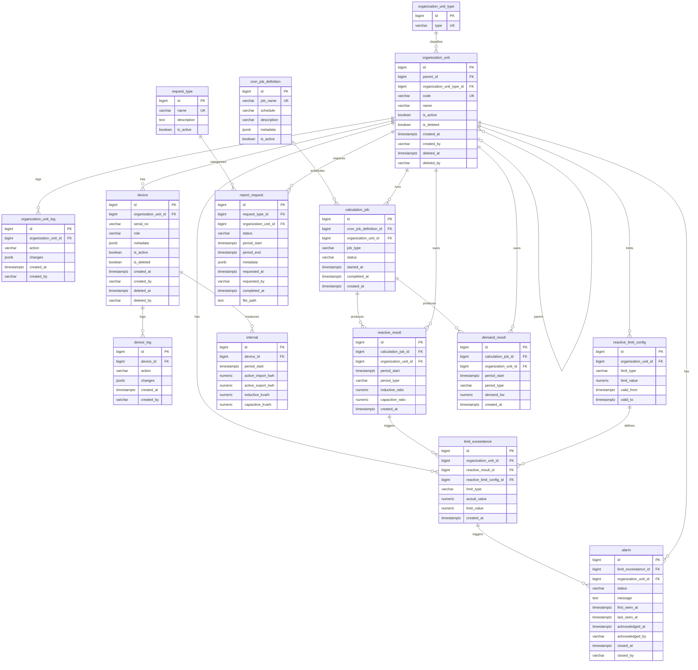

# D-02 — Entity Relationship Diagram

## 1. ERD

## 2. Constraints

- All tables use the `mini_pms` schema and auto-generated `BIGINT` primary keys.
- Foreign keys connect the tables as shown in the diagram.
- `organization_unit` and `device` use soft delete: deleted records are inactive and require `deleted_at` and `deleted_by`.
- `device.metadata`, `cron_job_definition.metadata`, and `report_request.metadata` are JSON objects.
- `interval` is unique on `(device_id, period_start)`; energy values cannot be negative.
- `reactive_limit_config` requires a nonnegative limit and `valid_to > valid_from` when an end date is provided.
- `reactive_result` and `demand_result` are unique on `(calculation_job_id, period_start, period_type)`; results cannot be negative.
- `limit_exceedance` requires `actual_value > limit_value`.
- `report_request` requires `period_end > period_start`; completed requests must have `completed_at`.

## 3. Status Values

| Field | Allowed values |
|---|---|
| `calculation_job.status` | `PENDING`, `RUNNING`, `COMPLETED`, `FAILED`, `NO_DATA` |
| `alarm.status` | `OPEN`, `ACKNOWLEDGED`, `CLOSED` |
| `report_request.status` | `PENDING`, `PROCESSING`, `COMPLETED`, `FAILED` |

## 4. Notes

- `cron_job_definition` stores schedules; `calculation_job` tracks executions.
- `limit_exceedance` records reactive limit violations; `alarm` tracks their acknowledgement and closure.
- `request_type` defines report categories; `report_request` tracks generation requests.
- Report period dates are separate columns in the current migration. They can be moved into `metadata` if that design is selected.

> **Before running migrations:** Fix the SQL syntax and timestamp ordering errors already identified. This diagram reflects the proposed migration structure, not a verified live database. The current `limit_exceedance` model references `reactive_result` only; demand-limit violations would require an additional design decision.
