# D-02 — Entity Relationship Diagram

## 1. Entity Relationship Diagram

```mermaid

erDiagram
    organization_unit_type {
        bigint id PK "NOT NULL"
        varchar type UK "NOT NULL"
    }

    organization_unit {
        bigint id PK "NOT NULL"
        bigint parent_id FK "NULL"
        bigint organization_unit_type_id FK "NOT NULL"
        varchar code UK "NOT NULL"
        varchar name "NOT NULL"
        timestamptz created_at "NOT NULL"
        varchar created_by "NOT NULL"
        timestamptz deleted_at "NULL"
        varchar deleted_by "NULL"
    }

    organization_unit_log {
        bigint id PK "NOT NULL"
        bigint organization_unit_id FK "NOT NULL"
        varchar action "NOT NULL"
        jsonb changes "NOT NULL"
        timestamptz created_at "NOT NULL"
        varchar created_by "NOT NULL"
    }

    device {
        bigint id PK "NOT NULL"
        bigint organization_unit_id FK "NOT NULL"
        varchar serial_no UK "NOT NULL"
        varchar role "NOT NULL"
        boolean is_active "NOT NULL, DEFAULT TRUE"
        timestamptz created_at "NOT NULL"
        varchar created_by "NOT NULL"
        timestamptz deleted_at "NULL"
        varchar deleted_by "NULL"
    }

    device_log {
        bigint id PK "NOT NULL"
        bigint device_id FK "NOT NULL"
        varchar action "NOT NULL"
        jsonb changes "NOT NULL"
        timestamptz created_at "NOT NULL"
        varchar created_by "NOT NULL"
    }

    reactive_limit_config {
        bigint id PK "NOT NULL"
        bigint organization_unit_id FK "NOT NULL"
        varchar limit_type "NOT NULL"
        numeric limit_value "NOT NULL"
        timestamptz valid_from "NOT NULL"
        timestamptz valid_to "NULL"
    }

    interval {
        bigint id PK "NOT NULL"
        bigint device_id FK "NOT NULL"
        timestamptz period_start "NOT NULL"
        numeric active_import_kwh "NOT NULL"
        numeric active_export_kwh "NOT NULL"
        numeric inductive_kvarh "NOT NULL"
        numeric capacitive_kvarh "NOT NULL"
    }

    cron_job_definition {
        bigint id PK "NOT NULL"
        varchar job_name UK "NOT NULL"
        varchar cron_expression "NOT NULL"
        boolean is_active "NOT NULL, DEFAULT TRUE"
    }

    calculation_job {
        bigint id PK "NOT NULL"
        bigint organization_unit_id FK "NOT NULL"
        bigint cron_job_definition_id FK "NULL"
        timestamptz period_start "NOT NULL"
        varchar status "NOT NULL, DEFAULT PENDING"
        integer retry_count "NOT NULL, DEFAULT 0"
        timestamptz created_at "NOT NULL"
    }

    reactive_result {
        bigint id PK "NOT NULL"
        bigint organization_unit_id FK "NOT NULL"
        bigint calculation_job_id FK "NOT NULL"
        timestamptz period_start "NOT NULL"
        varchar period_type "NOT NULL"
        numeric inductive_ratio "NULL"
        numeric capacitive_ratio "NULL"
    }

    demand_result {
        bigint id PK "NOT NULL"
        bigint organization_unit_id FK "NOT NULL"
        bigint calculation_job_id FK "NOT NULL"
        timestamptz period_start "NOT NULL"
        numeric demand_kw "NOT NULL"
    }

    limit_exceedance {
        bigint id PK "NOT NULL"
        bigint organization_unit_id FK "NOT NULL"
        bigint calculation_job_id FK "NOT NULL"
        bigint alarm_id FK "NULL"
        timestamptz period_start "NOT NULL"
        varchar exceedance_type "NOT NULL"
        numeric measured_value "NOT NULL"
        numeric limit_value "NOT NULL"
    }

    alarm {
        bigint id PK "NOT NULL"
        bigint organization_unit_id FK "NOT NULL"
        varchar alarm_type "NOT NULL"
        varchar status "NOT NULL"
        integer occurrence_count "NOT NULL, DEFAULT 1"
        timestamptz last_seen_at "NOT NULL"
        varchar acknowledged_by "NULL"
    }

    request_type {
        bigint id PK "NOT NULL"
        varchar type UK "NOT NULL"
    }

    report_request {
        bigint id PK "NOT NULL"
        bigint organization_unit_id FK "NOT NULL"
        bigint request_type_id FK "NOT NULL"
        varchar status "NOT NULL, DEFAULT PENDING"
        varchar output_path "NULL"
        uuid worker_token "NULL"
        jsonb parameters "NOT NULL"
        varchar requested_by "NOT NULL"
        integer attempt_count "NOT NULL, DEFAULT 0"
        timestamptz started_at "NULL"
        timestamptz completed_at "NULL"
        varchar last_error "NULL"
        timestamptz created_at "NOT NULL"
        timestamptz locked_until "NULL"
    }

    organization_unit_type ||--o{ organization_unit : classifies
    organization_unit o|--o{ organization_unit : parent
    organization_unit ||--o{ organization_unit_log : logs
    organization_unit ||--o{ device : devices
    device ||--o{ device_log : logs
    organization_unit ||--o{ reactive_limit_config : limits
    device ||--o{ interval : intervals

    organization_unit ||--o{ calculation_job : jobs
    cron_job_definition o|--o{ calculation_job : schedules

    calculation_job ||--o{ reactive_result : produces
    calculation_job ||--o{ demand_result : produces
    calculation_job ||--o{ limit_exceedance : detects

    organization_unit ||--o{ reactive_result : reactive
    organization_unit ||--o{ demand_result : demand
    organization_unit ||--o{ limit_exceedance : exceedances

    organization_unit ||--o{ alarm : alarms
    alarm o|--o{ limit_exceedance : associated_with

    request_type ||--o{ report_request : categorizes
    organization_unit ||--o{ report_request : reports

```



## 2. Constraints and Indexes

All tables belong to the `mini_pms` schema.

```sql
-- Prevent duplicate intervals for the same device and period.
ALTER TABLE mini_pms.interval
ADD CONSTRAINT uq_interval_device_period
UNIQUE (device_id, period_start);

-- Support efficient scanning of calculation jobs.
CREATE INDEX idx_calculation_job_status_period
ON mini_pms.calculation_job (status, period_start);

-- Allow at most one active MAIN device per organization unit.
CREATE UNIQUE INDEX uq_device_active_main
ON mini_pms.device (organization_unit_id)
WHERE role = 'MAIN'
  AND is_active = TRUE
  AND deleted_at IS NULL;

-- Allow at most one non-closed alarm per organization unit and type.
CREATE UNIQUE INDEX uq_alarm_active
ON mini_pms.alarm (organization_unit_id, alarm_type)
WHERE status <> 'CLOSED';

-- Prevent duplicate system-generated reports.
CREATE UNIQUE INDEX uq_report_system_period
ON mini_pms.report_request (
    request_type_id,
    organization_unit_id,
    (parameters->>'period')
)
WHERE requested_by = 'system';

-- Prevent duplicate reactive results for the same period.
CREATE UNIQUE INDEX uq_reactive_result_period
ON mini_pms.reactive_result (
    organization_unit_id,
    period_type,
    period_start
);

-- Prevent duplicate demand results for the same period.
CREATE UNIQUE INDEX uq_demand_result_period
ON mini_pms.demand_result (
    organization_unit_id,
    period_start
);

-- Prevent duplicate exceedance records after recalculation.
CREATE UNIQUE INDEX uq_limit_exceedance_period
ON mini_pms.limit_exceedance (
    organization_unit_id,
    period_start,
    exceedance_type
);

-- System-generated reports must include a non-empty period.
ALTER TABLE mini_pms.report_request
ADD CONSTRAINT chk_system_report_period
CHECK (
    requested_by <> 'system'
    OR (
        parameters->>'period' IS NOT NULL
        AND btrim(parameters->>'period') <> ''
    )
);

-- Retry attempts cannot be negative.
ALTER TABLE mini_pms.report_request
ADD CONSTRAINT chk_report_attempt_count
CHECK (attempt_count >= 0);

-- An in-progress report must have an owner and a lease.
ALTER TABLE mini_pms.report_request
ADD CONSTRAINT chk_report_worker_lease
CHECK (
    status <> 'IN_PROGRESS'
    OR (
        worker_token IS NOT NULL
        AND locked_until IS NOT NULL
        AND started_at IS NOT NULL
    )
);

-- A completed report must reference its output.
ALTER TABLE mini_pms.report_request
ADD CONSTRAINT chk_report_completed_output
CHECK (
    status <> 'COMPLETED'
    OR (
        output_path IS NOT NULL
        AND completed_at IS NOT NULL
    )
);

-- Speed up recovery of expired report leases.
CREATE INDEX idx_report_request_expired_lease
ON mini_pms.report_request (locked_until)
WHERE status = 'IN_PROGRESS';

```

## 3. Status and Type Values

| Field | Allowed Values |
|---|---|
| `organization_unit_type.type` | `SUBSTATION`, `TRANSFORMER`, `FEEDER` |
| `device.role` | `MAIN`, `FEEDER` |
| `calculation_job.status` | `PENDING`, `IN_PROGRESS`, `COMPLETED`, `FAILED`, `NO_DATA` |
| `reactive_result.period_type` | `QUARTER_HOUR`, `DAILY`, `MONTHLY` |
| `limit_exceedance.exceedance_type` | `INDUCTIVE`, `CAPACITIVE`, `IMPORT_DEMAND`, `EXPORT_DEMAND` |
| `alarm.alarm_type` | `INDUCTIVE`, `CAPACITIVE`, `IMPORT_DEMAND`, `EXPORT_DEMAND` |
| `alarm.status` | `OPEN`, `ACKNOWLEDGED`, `CLOSED` |
| `request_type.type` | `MONTHLY_REACTIVE`, `EXCEEDANCE_LIST` |
| `report_request.status` | `PENDING`, `IN_PROGRESS`, `COMPLETED`, `FAILED` |
| `organization_unit_log.action`, `device_log.action` | `CREATE`, `UPDATE`, `DELETE` |

These values form the proposed initial application model.

Values not explicitly defined in the requirements must be confirmed before implementing migrations.

## 4. Audit and Soft Delete

- `created_at` stores the record creation timestamp.
- `created_by` stores the username responsible for creation.
- `deleted_at` and `deleted_by` support soft deletion.
- `organization_unit_log` and `device_log` preserve changes to organization unit and device data.
- `acknowledged_by` identifies the operator who acknowledged an alarm.
- `requested_by` identifies the user or system requesting a report.

- `worker_token` is a UUID identifying the current report-processing attempt.
  It is not a user identifier.
- `requested_by` identifies the user or system that created the report request.
- `attempt_count` tracks how many times a report request has been claimed
  for processing.

User identities are managed by Keycloak.

The `preferred_username` claim from the access token is stored in audit fields. Mini-PMS does not maintain a local user table.

## 5. Business Rules

### 5.1 Organization Unit Hierarchy

The `organization_unit.parent_id` field references `organization_unit.id`.

The hierarchy has three levels:

`SUBSTATION -> TRANSFORMER -> FEEDER`

Each organization unit references `organization_unit_type.id` through `organization_unit_type_id`.

PostgreSQL recursive CTEs can retrieve the hierarchy.

Neo4j is used for topology traversal.

### 5.2 Device Selection

Each organization unit can have at most one active, non-deleted MAIN device.

Calculation logic must select the correct MAIN devices to avoid double-counting energy measurements.

### 5.3 Interval Data

The `interval` table stores energy measurements for each device and period.

Each interval belongs to one device.

The combination of `device_id` and `period_start` must be unique.

### 5.4 Reactive Calculation

Reactive ratios are calculated using:

Inductive ratio = SUM(inductive_kvarh) / SUM(active_import_kwh)

Capacitive ratio = SUM(capacitive_kvarh) / SUM(active_import_kwh)

Daily and monthly ratios use aggregated energy values, not averages of individual 15-minute ratios.

Division by zero must be handled.

### 5.5 Demand Calculation

For a 15-minute interval:

Demand (kW) = Active energy (kWh) * 4

The calculated demand is compared with the configured consumption or production power limit.

### 5.6 Limit Exceedance and Alarm

Configured limits are stored in `reactive_limit_config`.

When a calculated value exceeds its applicable limit, a `limit_exceedance` record is created.

The Alarm Service processes exceedance events and creates or updates an alarm.

An existing non-closed alarm for the same organization unit and alarm type must be updated rather than duplicated.

### 5.7 Calculation Jobs

The scheduler reads `cron_job_definition`.

Every 15 minutes, calculation jobs are created for active organization units.

Workers process jobs through RabbitMQ.

A failed job can be retried up to three times.

A job with missing interval data can enter `NO_DATA`.


### 5.8 Report Requests

The `request_type` table defines the available report types.

Each `report_request` references `request_type.id`
through `request_type_id`.

System-generated reports must be unique for the combination of:

- `request_type_id`
- `organization_unit_id`
- `parameters->>'period'`

This uniqueness rule applies only when
`requested_by = 'system'`.

System-generated report requests must include a non-empty
`period` parameter.

Manually requested reports may have multiple request records
for the same report type, organization unit, and period.

The unique index prevents duplicate system-generated
request records.

Worker-level idempotency is handled separately to prevent
duplicate final report outputs for the same request.

### 5.9 Report Worker Idempotency

Report generation is processed asynchronously by workers
through RabbitMQ.

RabbitMQ messages may be redelivered if a worker crashes
or fails to acknowledge a message.

Each report request has a unique `id`, which is used
as the idempotency key.

A worker claims a report request through an atomic
database update.

The `worker_token` identifies the current processing
attempt, while `locked_until` defines the lease
expiration time.

The `attempt_count` field tracks processing attempts.

A healthy worker may renew its lease while generating
a report.

If the lease expires, another worker may reclaim
the request.

An expired worker must not be allowed to mark the
request as completed after ownership has changed.

PDF files are generated using temporary output locations
associated with individual processing attempts.

Each report request has a deterministic final output path,
for example:

`reports/{request_id}/report.pdf`

The final output is stored in persistent storage.

Atomic create-if-absent operations prevent overwriting
an existing final report object.

However, create-if-absent alone does not prevent an
expired worker from publishing first.

Final output publication must therefore be coordinated
with worker ownership and validated before the request
is marked as completed.

If a worker crashes after storing the PDF but before
updating PostgreSQL, a retrying worker can verify the
existing output and recover the request.

The request is marked as `COMPLETED` only after the
final output has been successfully stored and verified.

RabbitMQ acknowledgment is sent only after durable
completion has been confirmed.

This design targets one valid final output per report
request, although report computation may be retried.


## 6. Data Growth

The `interval` table is expected to grow fastest.

500 devices * 96 intervals/day * 365 days

= 17,520,000 rows/year.

Monthly table partitioning is an optional optimization.

## 7. Migration Rules

- The ERD is the source of truth for database migrations.
- Every migration PR must include the updated ERD.
- Primary keys use auto-incrementing `bigint`.
- Timestamps use `timestamptz` and UTC.
- Energy and ratio values use `numeric`.
- Foreign keys must reference the updated table names.
- `organization_unit_type` and `request_type` require initial seed data.
- Database migrations must preserve all uniqueness and referential integrity constraints.
- `report_request.status` defaults to `PENDING`.
- `report_request.attempt_count` defaults to `0`.
- Nullable report-processing fields remain NULL until
  their corresponding processing stage.
- Report-processing state transitions must preserve
  worker ownership and lease consistency.
- System-generated report requests must include a
  non-empty period parameter.
- Database migrations must implement the documented
  CHECK constraints and indexes.
- Report output storage must support safe publication
  and recovery after worker failures.
