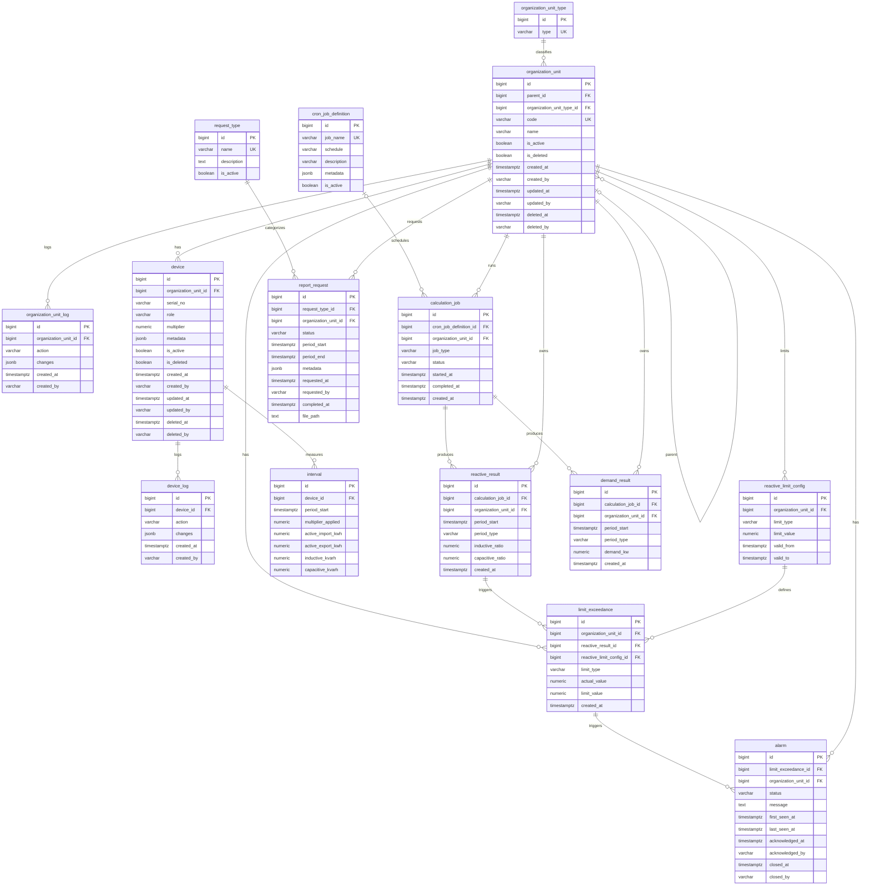
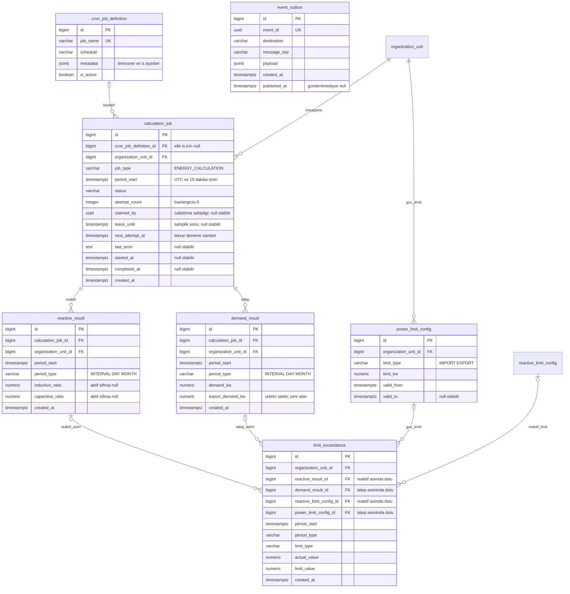

# D-02 — Veri modeli

F4 başlangıç revizyonu. İlk çizim mevcut migration dosyalarını gösterir.
F4 için gereken ek alan ve kurallar aşağıda ayrı gösterildi; henüz migration uygulanmadı.

## Mevcut tablolar

## Mevcut kurallar

- Tablolar `mini_pms` şemasında. Kimlikler `BIGINT`; TypeScript tarafında string kullanılır.
- `organization_unit.parent_id` boş olabilir; kök birimin üst birimi yoktur.
- Birim ve cihazlar soft-delete kullanır. Aktif ve silinmemiş kayıtlar işleme alınır.
- Sayaç rolü yalnız `MAIN` veya `FEEDER`; `multiplier` pozitif NUMERIC(18,6), varsayılan 1.
- `device.serial_no` silinmiş kayıtlar dahil unique. Aynı birimde aktif ve silinmemiş
  MAIN sayaç için partial unique index var; ikinci aktif MAIN oluşturulamaz.
- Ingestion dört ham enerjiyi SQL NUMERIC ile çarpar. `interval.multiplier_applied`
  ilk kayıt çarpanını saklar; tekrar gelen ölçüm bu çarpanla karşılaştırılır.
  Redis'e de çarpılmış DB değerleri gider. Eski ölçümler çarpan 1 ile korunur.
- `interval` için `(device_id, period_start)` unique. Enerjiler negatif olamaz.
- `cron_job_definition.job_name` unique. `schedule` zamanlamayı tutar; metadata JSON nesnesidir.
- `calculation_job.cron_job_definition_id` boş olabilir; elle başlatılan iş cron'a bağlı olmayabilir.
- İşte `started_at` ve `completed_at` başlangıçta boştur.
- Mevcut sonuç unique anahtarı `(calculation_job_id, period_start, period_type)`.
  Farklı job ID ile yeniden hesaplamada bu anahtar tek başına yeterli değildir.
- Reaktif limitlerin bitiş tarihi boş olabilir. Aynı birim ve limit türünde tarih aralıkları çakışamaz.
- Mevcut `limit_exceedance` yalnız reaktif sonuca ve reaktif limite bağlıdır.
  Talep aşımı için aşağıdaki genişletme gerekir.

## F4 için eklenecek alanlar

Bu çizim bir tasarım önerisidir. Yeni migration ile uygulanacak; eski migration dosyaları değiştirilmeyecek.
`calculation_job` tek birim ve tek 15 dakikalık dönem için reaktif + talep hesabını temsil eder.
Günlük/aylık kümülatif sonuçlar da aynı çalıştırmada güncellenir.

`event_outbox` mesajı kalıcı saklar. Job/sonuç ile aynı PostgreSQL transaction'ında yazılır.
Ayrı bir gönderici bekleyen mesajları RabbitMQ veya Kafka'ya iletir. Broker onayı alınca
`published_at` doldurulur. Onaydan sonra uygulama kapanırsa tekrar gönderilebilir;
tüketici job ID veya event ID ile tekrarları ayırır. Bu, mesajın yalnız bir kez teslim edildiği anlamına gelmez.

## F4 unique ve index kuralları

| Yer | Kural | Neden? |
|---|---|---|
| `calculation_job` | UNIQUE `(organization_unit_id, job_type, period_start)` | Üç replika aynı birim/dönem için tek iş oluşturur. |
| `calculation_job` | INDEX `(status, period_start)` | Bekleyen işleri bulmak. |
| `calculation_job` | INDEX `(status, lease_until)` | Süresi dolmuş RUNNING işleri kurtarmak. |
| Sonuç tabloları | UNIQUE `(organization_unit_id, period_start, period_type)` | Yeni job ID ile yeniden hesaplama da aynı sonucu günceller. |
| `limit_exceedance` | UNIQUE `(organization_unit_id, period_start, period_type, limit_type)` | Aynı dönem yeniden hesaplanınca ikinci aşım oluşmaz. |
| `power_limit_config` | Aynı birim/tür için tarih aralıkları çakışmaz | O dönemde uygulanacak limit belli olur. |
| `event_outbox` | UNIQUE `event_id`; gönderilmeyen satırlar için index | Tek olayı takip etmek ve bekleyen mesajları bulmak. |

- Job unique anahtarına nullable cron ID koymuyoruz; elle başlatılan hesap da aynı dönemi temsil eder.
- Yeniden hesaplama yeni duplicate job eklemek yerine mevcut işi güvenli biçimde tekrar sıraya alır.
  Aktif bir RUNNING iş eşzamanlı yeniden başlatılmaz. Sonuçlar yeniden hesaplanırken eski aşım
  artık geçerli değilse silme/geçersizleştirme davranışı F4-T5'te tamamlanır.
- Sonuçlarda `calculation_job_id` hesabın kaynağını gösterir; iş anahtarı değildir.
- `demand_kw` çekiş talebidir. Veriş talebi yeni `export_demand_kw` alanında tutulur;
  böylece tüketim ve üretim limitleri ayrı karşılaştırılır.
- Aşımda tam bir sonuç/limit çifti dolu olmalı: reaktif+reaktif limit veya talep+güç limiti.
  CHECK constraint ile iki çiftin aynı anda dolması veya ikisinin de boş olması engellenir.
- `period_start` dönem başlangıcıdır; `created_at` kaydın yazılma zamanıdır.
- `attempt_count` 0–3 arasında olur. Sahiplik token'ı eski worker'ın sonuç yazmasını engeller.
- Aktif enerji sıfırsa reaktif oran tanımsızdır; sıfıra bölünmez, oran alanları null tutulur.
  Ölçüm yoksa ise iş `NO_DATA` olur. Negatif enerjiler hesaplamaya alınmaz.

## Durumlar ve sonraki faz

| Alan | Değerler |
|---|---|
| `calculation_job.status` | `PENDING`, `RUNNING`, `COMPLETED`, `FAILED`, `NO_DATA` |
| `alarm.status` | `OPEN`, `ACKNOWLEDGED`, `CLOSED` |
| `report_request.status` | `PENDING`, `PROCESSING`, `COMPLETED`, `FAILED` |

Yönergede geçen `IN_PROGRESS`, mevcut şemadaki `RUNNING` durumuna karşılık gelir.
İkinci bir durum adı eklemiyoruz.

F5'te alarm için `alarm_type`, `occurrence_count` ve aynı birim/türde kapatılmamış
alarmı tek tutan partial unique index gerekecek. Aynı Kafka olayının tekrarında sayacın
artmaması için tüketilen event ID de kalıcı tutulacak. Bunlar mevcut alarm migration'ında yok.
Rapor tabloları bu F4 revizyonunda değiştirilmedi.
