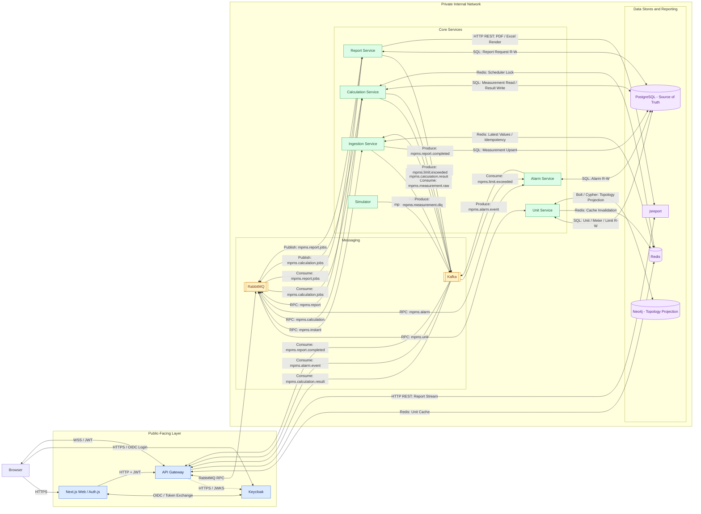
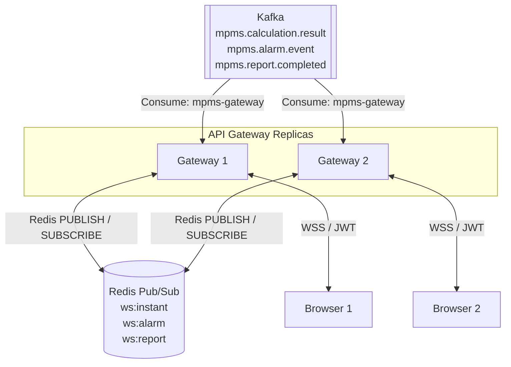

# D-01 — Mini-PMS High Level Design

## 1. System Architecture





### Architecture Explanation

1. The system separates public-facing components from internal backend services and infrastructure.
2. Next.js handles user authentication through Keycloak, while the API Gateway validates JWT access tokens locally using JWKS.
3. Synchronous requests use HTTP and RabbitMQ RPC, while asynchronous measurement and event processing uses Kafka and RabbitMQ work queues.
4. The Unit, Ingestion, Calculation, Alarm, and Report services handle their respective business responsibilities.
5. PostgreSQL is the primary source of truth, while Neo4j maintains a derived projection of the electrical network topology.
6. Redis provides caching, latest measurement storage, idempotency checks, and distributed scheduler locks.
7. Invalid measurement messages are sent to `mpms.measurement.dlq`, and failed calculation jobs can be handled through `mpms.calculation.jobs.dlx`.
8. jsreport generates PDF and Excel documents, while the API Gateway provides authorized report downloads.
9. Authenticated browser clients receive real-time notifications through WebSocket connections to the API Gateway.

## 2. Multi-Replica WebSocket Distribution





### WebSocket Explanation

1. API Gateway replicas consume Kafka events using the `mpms-gateway` consumer group.
2. Kafka distributes event consumption among the replicas according to partition assignments.
3. A Gateway replica receiving an event publishes the notification to the corresponding Redis Pub/Sub channel.
4. All Gateway replicas subscribe to `ws:instant`, `ws:alarm`, and `ws:report`.
5. Each Gateway forwards relevant notifications to its connected WebSocket clients.
6. WebSocket connections require valid authentication and enforce authorization.
7. If a Gateway replica disconnects, its clients must reconnect, and Redis Pub/Sub does not retain missed notifications.
```
