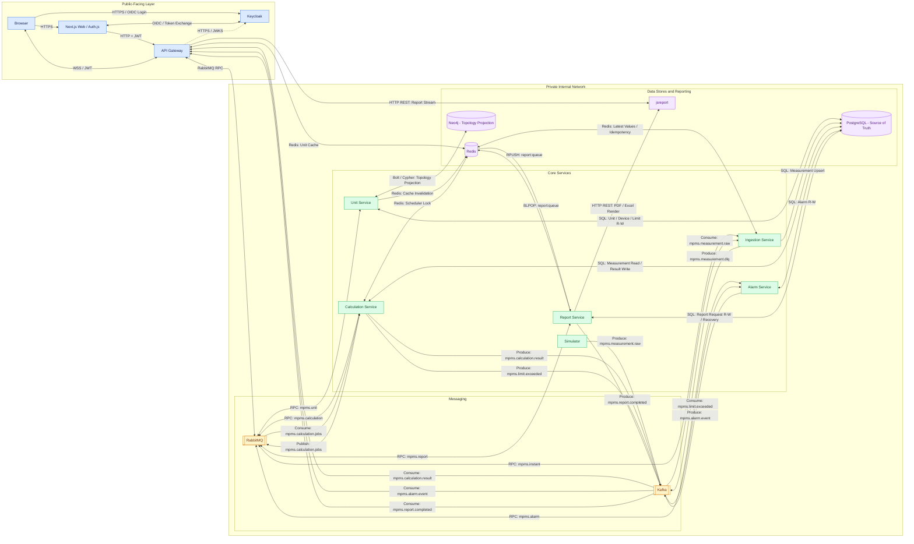
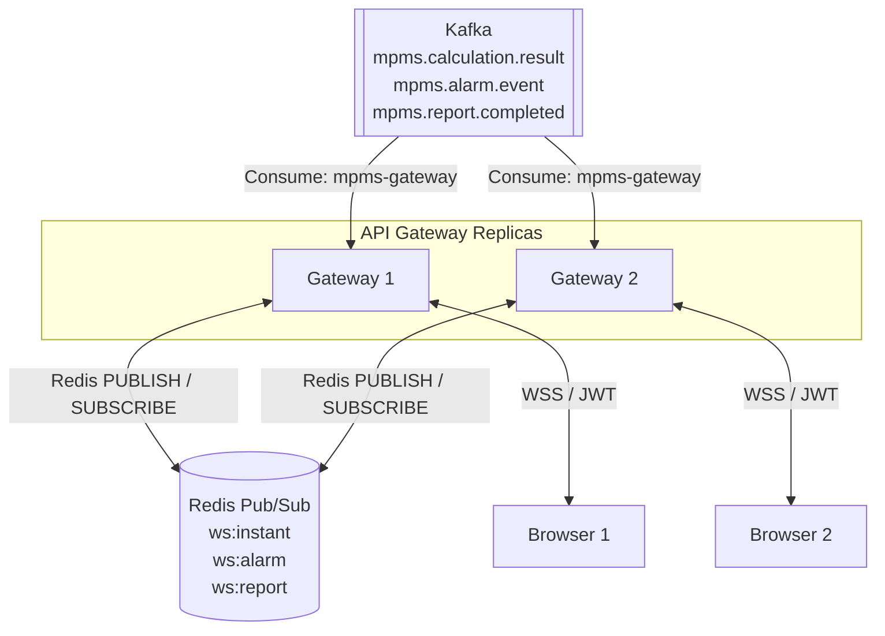

# D-01 — Mini-PMS High Level Design

## 1. System Architecture

### Architecture Explanation

1. The Public-Facing Layer contains Next.js, Keycloak, and API Gateway.
2. RabbitMQ handles synchronous RPC and calculation jobs; Kafka handles measurements and asynchronous events.
3. Core Services implement unit management, ingestion, calculations, alarms, and reporting.
4. PostgreSQL is the source of truth, while Neo4j maintains the electrical topology projection.
5. Redis handles caching, latest measurements, scheduler locks, and report job queues.
6. Report Service uses Redis `RPUSH` and `BLPOP` with a single worker pod.
7. jsreport generates PDF and Excel documents.
8. API Gateway delivers real-time notifications through WebSocket.

## 2. Multi-Replica WebSocket Distribution

### WebSocket Explanation

1. Gateway replicas consume Kafka events through the `mpms-gateway` consumer group.
2. Kafka distributes events according to partition assignments.
3. The consuming Gateway publishes notifications to Redis Pub/Sub.
4. All Gateway replicas subscribe to `ws:instant`, `ws:alarm`, and `ws:report`.
5. Each Gateway forwards notifications to its connected WebSocket clients.
6. WebSocket connections require authentication and authorization.
7. Redis Pub/Sub does not retain missed notifications.
