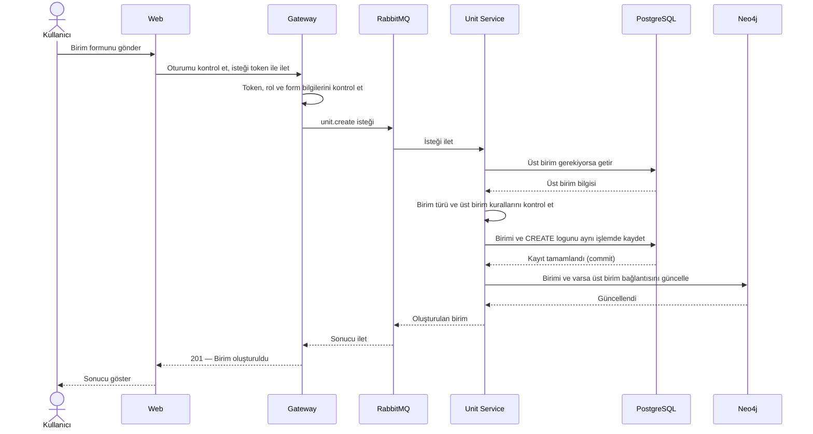

# D-03 — Birim oluşturma

Kullanıcı formu doldurur. İstek Gateway üzerinden Unit Service'e gider.
Birim ve işlem logu birlikte kaydedilir, ardından Neo4j güncellenir.

Bu çizim başarılı işlemi gösteriyor. Hata olursa:

- Giriş veya yetki yoksa istek reddedilir.
- Üst birim uygun değilse birim oluşturulmaz.
- Birim ya da log kaydedilemezse ikisi de geri alınır.
- Neo4j güncellenemezse hata döner, ama PostgreSQL kaydı kalır.

Üst birim kuralı: trafo merkezi köktür; transformatör trafo merkezine,
fider ise transformatöre bağlanır. Seçilen üst birim aktif olmalıdır.
