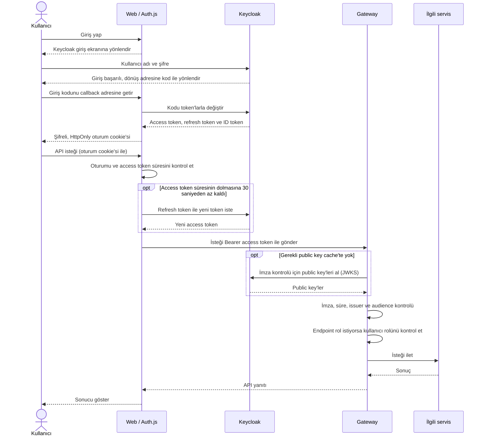

# D-04 — Keycloak ile giriş ve yetkili istek

Kullanıcı Keycloak ekranından giriş yapar. Web uygulaması oturumu cookie'de
tutar. Bir API isteği yapılınca access token'ı Gateway'e Web sunucusu ekler.

Bu çizim başarılı giriş ve isteği gösteriyor. Hata olursa:

- Kullanıcı adı veya şifre yanlışsa Keycloak girişe izin vermez.
- Oturum yoksa veya token yenilenemezse Web proxy API isteğine 401 döner.
- Gateway eksik, geçersiz veya süresi dolmuş token için 401 döner.
- Token geçerli ama kullanıcının rolü yetersizse Gateway 403 döner.

Tarayıcıdaki JavaScript access token'ı doğrudan okumaz. Cookie isteğe otomatik
eklenir, Gateway'e giden Bearer token'ı Web sunucusu yerleştirir.
Normal `/api/auth/session` yanıtında access token bulunmaz.

Gateway her istekte Keycloak'a token doğrulatmaz. JWT'yi public key ile kendisi
kontrol eder; public key'ler gerektiğinde Keycloak'tan alınır ve cache'lenir.
Beklenen audience `mini-pms-api`, imza algoritması `RS256`dır.
